

<a name="portrait"></a>

&nbsp;&nbsp;

I build **NLP and multimodal AI systems end to end** — from reading the paper, to a faithful
implementation with tests, to a Docker image someone else can actually run.
*Faithful to the paper first. Optimised second. Always reproducible.*

- **Reproductions that hold up** — ACL/NAACL baselines rebuilt line by line against the paper,
  with the deliberate deviations documented so nobody silently "optimises" them away.
- **Not just notebooks** — most projects ship a FastAPI/Gradio service, a React UI, a Dockerfile
  and a test suite: research code that runs on a stranger's machine.

<!--techstack-->

<a name="stack-languages-panel"></a>

↗ <a href="https://github.com/hotuyen21pt/Prism">Prism</a> · <a href="https://github.com/hotuyen21pt/CXR-VQA-custom">CXR-VQA-custom</a> · <a href="https://github.com/hotuyen21pt/EvidenceKD-MedVQA">EvidenceKD-MedVQA</a> · <a href="https://github.com/hotuyen21pt/MultiLABSA">MultiLABSA</a> · <a href="https://github.com/hotuyen21pt/Smart-Warehouse-Management">Smart-Warehouse-Management</a> · <a href="https://github.com/hotuyen21pt/work_reminder">work_reminder</a> · <a href="https://github.com/hotuyen21pt/KLTN-Token-Merging">KLTN-Token-Merging</a> · <a href="https://github.com/hotuyen21pt/Book-Management">Book-Management</a> · <a href="https://github.com/hotuyen21pt/s2it">s2it</a> · <a href="https://github.com/hotuyen21pt/tree">tree</a> · <a href="https://github.com/hotuyen21pt/Automatic-Labelling-Engine-with-LLM">Automatic-Labelling-Engine-with-LLM</a> · <a href="https://github.com/hotuyen21pt/Customer_Segmentation">Customer_Segmentation</a>

<a name="stack-ml-panel"></a>

↗ <a href="https://github.com/hotuyen21pt/CXR-VQA-custom">CXR-VQA-custom</a> · <a href="https://github.com/hotuyen21pt/EvidenceKD-MedVQA">EvidenceKD-MedVQA</a> · <a href="https://github.com/hotuyen21pt/KLTN-Token-Merging">KLTN-Token-Merging</a> · <a href="https://github.com/hotuyen21pt/MultiLABSA">MultiLABSA</a> · <a href="https://github.com/hotuyen21pt/s2it">s2it</a> · <a href="https://github.com/hotuyen21pt/tree">tree</a> · <a href="https://github.com/hotuyen21pt/Customer_Segmentation">Customer_Segmentation</a> · <a href="https://github.com/hotuyen21pt/House-price-prediction">House-price-prediction</a> · <a href="https://github.com/hotuyen21pt/text-classification">text-classification</a> · <a href="https://github.com/hotuyen21pt/Smart-Warehouse-Management">Smart-Warehouse-Management</a> · <a href="https://github.com/hotuyen21pt/Detect-CCCD">Detect-CCCD</a> · <a href="https://github.com/hotuyen21pt/Prism">Prism</a>

<a name="stack-models-panel"></a>

↗ <a href="https://github.com/hotuyen21pt/CXR-VQA-custom">CXR-VQA-custom</a> · <a href="https://github.com/hotuyen21pt/Split_Sentence">Split_Sentence</a> · <a href="https://github.com/hotuyen21pt/KLTN-Token-Merging">KLTN-Token-Merging</a> · <a href="https://github.com/hotuyen21pt/MultiLABSA">MultiLABSA</a> · <a href="https://github.com/hotuyen21pt/Prism">Prism</a> · <a href="https://github.com/hotuyen21pt/EvidenceKD-MedVQA">EvidenceKD-MedVQA</a>

<a name="stack-infra-panel"></a>

↗ <a href="https://github.com/hotuyen21pt/KLTN-Token-Merging">KLTN-Token-Merging</a> · <a href="https://github.com/hotuyen21pt/Detect-CCCD">Detect-CCCD</a> · <a href="https://github.com/hotuyen21pt/Book-Management">Book-Management</a> · <a href="https://github.com/hotuyen21pt/Smart-Warehouse-Management">Smart-Warehouse-Management</a> · <a href="https://github.com/hotuyen21pt/MultiLABSA">MultiLABSA</a> · <a href="https://github.com/hotuyen21pt/CXR-VQA-custom">CXR-VQA-custom</a> · <a href="https://github.com/hotuyen21pt/Prism">Prism</a> · <a href="https://github.com/hotuyen21pt/hotuyen21pt">hotuyen21pt</a> · <a href="https://github.com/hotuyen21pt/Split_Sentence">Split_Sentence</a> · <a href="https://github.com/hotuyen21pt/EvidenceKD-MedVQA">EvidenceKD-MedVQA</a> · <a href="https://github.com/hotuyen21pt/s2it">s2it</a> · <a href="https://github.com/hotuyen21pt/tree">tree</a>

<!--/techstack-->

<!--projects-->

<a href="https://github.com/hotuyen21pt/Prism"></a>&nbsp;<a href="https://github.com/hotuyen21pt/KLTN-Token-Merging"></a>
  
<a href="https://github.com/hotuyen21pt/CXR-VQA-custom"></a>&nbsp;<a href="https://github.com/hotuyen21pt/EvidenceKD-MedVQA"></a>
  
<a href="https://github.com/hotuyen21pt/MultiLABSA"></a>&nbsp;<a href="https://github.com/hotuyen21pt/s2it"></a>
  
<a href="https://github.com/hotuyen21pt/Smart-Warehouse-Management"></a>&nbsp;<a href="https://github.com/hotuyen21pt/Detect-CCCD"></a>

<!--/projects-->

<b>More projects</b>

 

| Project | What it is | Stack |
|---|---|---|
| [tree](https://github.com/hotuyen21pt/tree) | **Tree-CoT-RT** (ACL 2026) — the second baseline in the S2IT card: reasoning trees, tSFT, then GRPO with a rule-based reward | `GRPO` · `LoRA` |
| [Split_Sentence](https://github.com/hotuyen21pt/Split_Sentence) | **UOS segmentation** — splits reviews into "one opinion, one target" units with Qwen3-8B via Ollama; streaming pipeline with gold-case validation and token-recall metrics | `Qwen3` · `Ollama` · `Python` |
| [work_reminder](https://github.com/hotuyen21pt/work_reminder) | Telegram work-reminder bot, written in idiomatic Go with a clean `cmd/internal` layout | `Go` · `Telegram API` |
| [Automatic-Labelling-Engine-with-LLM](https://github.com/hotuyen21pt/Automatic-Labelling-Engine-with-LLM) | LLM-driven automatic annotation engine for ABSA datasets | `LLM` · `Jupyter` |
| [Book-Management](https://github.com/hotuyen21pt/Book-Management) | CRUD service with Alembic migrations, schema verification and Docker Compose | `FastAPI` · `Alembic` · `Docker` |
| [Report-BlackList](https://github.com/hotuyen21pt/Report-BlackList) | Community scam-report platform — spec'd as user stories with a 30-day vote-based promotion rule | `Python` · `Product spec` |
| [Customer_Segmentation](https://github.com/hotuyen21pt/Customer_Segmentation) · [House-price-prediction](https://github.com/hotuyen21pt/House-price-prediction) · [text-classification](https://github.com/hotuyen21pt/text-classification) | Classical ML — clustering, regression and text classification with full EDA | `scikit-learn` · `Pandas` |

&nbsp;

*"Faithfulness to the paper matters more than peak F1 — until you can prove otherwise."*

