<div align="center">


<br/>

<a href="https://github.com/hotuyen21pt?tab=repositories"></a>
<a href="mailto:tuyennh2102@gmail.com"></a>


</div>

## 👋 About me

I build **NLP and multimodal AI systems end to end** — from reading the paper, to a faithful
implementation with tests, to a Docker image someone else can actually run.

```python
class TuyenHoNguyen:
    focus       = ["Aspect-Based Sentiment Analysis", "Medical VQA", "LLM fine-tuning"]
    methods     = ["LoRA / PEFT", "Knowledge Distillation", "GRPO", "Multi-task learning"]
    ships_with  = ["pytest", "Docker", "FastAPI", "Kaggle-reproducible notebooks"]
    principle   = "Faithful to the paper first. Optimised second. Always reproducible."
```

- 🔬 **Research** — Aspect Sentiment Quad Prediction (ASQP) on Vietnamese & multilingual hotel reviews,
  and evidence-grounded Visual Question Answering on chest X-rays.
- 🧪 **Reproductions that hold up** — ACL/NAACL baselines rebuilt line-by-line against the paper,
  with the deliberate deviations documented so nobody silently "optimises" them away.
- 🛠️ **Not just notebooks** — most projects ship a FastAPI/Gradio service, a React UI, a Dockerfile
  and a test suite. Research code that runs on a stranger's machine.
- 🧭 **Vietnamese-first NLP** — ABSA, OCR and clause segmentation tuned for Vietnamese text.

<div align="center"></div>

## 🧰 Technology arsenal

<sub>Click any tile to see what I use it for and where.</sub>

<!--techstack-->
<table>
<tr>
<td align="center" valign="top"><details><summary><a name="tech-python"></a></summary><a name="note-python"></a><br/><sub>↗ <a href="https://github.com/hotuyen21pt/Prism">Prism</a><br/>↗ <a href="https://github.com/hotuyen21pt/CXR-VQA-custom">CXR-VQA-custom</a><br/>↗ <a href="https://github.com/hotuyen21pt/EvidenceKD-MedVQA">EvidenceKD-MedVQA</a><br/>↗ <a href="https://github.com/hotuyen21pt/MultiLABSA">MultiLABSA</a></sub></details></td>
<td align="center" valign="top"><details><summary><a name="tech-go"></a></summary><a name="note-go"></a><br/><sub>↗ <a href="https://github.com/hotuyen21pt/Smart-Warehouse-Management">Smart-Warehouse-Management</a><br/>↗ <a href="https://github.com/hotuyen21pt/work_reminder">work_reminder</a></sub></details></td>
<td align="center" valign="top"><details><summary><a name="tech-typescript"></a></summary><a name="note-typescript"></a><br/><sub>↗ <a href="https://github.com/hotuyen21pt/Smart-Warehouse-Management">Smart-Warehouse-Management</a></sub></details></td>
<td align="center" valign="top"><details><summary><a name="tech-javascript"></a></summary><a name="note-javascript"></a><br/><sub>↗ <a href="https://github.com/hotuyen21pt/KLTN-Token-Merging">KLTN-Token-Merging</a><br/>↗ <a href="https://github.com/hotuyen21pt/CXR-VQA-custom">CXR-VQA-custom</a></sub></details></td>
<td align="center" valign="top"><details><summary><a name="tech-sql"></a></summary><a name="note-sql"></a><br/><sub>↗ <a href="https://github.com/hotuyen21pt/Book-Management">Book-Management</a></sub></details></td>
<td align="center" valign="top"><details><summary><a name="tech-shell"></a></summary><a name="note-shell"></a></details></td>
</tr>
<tr>
<td align="center" valign="top"><details><summary><a name="tech-powershell"></a></summary><a name="note-powershell"></a></details></td>
<td align="center" valign="top"><details><summary><a name="tech-git"></a></summary><a name="note-git"></a><br/><sub>↗ <a href="https://github.com/hotuyen21pt/s2it">s2it</a><br/>↗ <a href="https://github.com/hotuyen21pt/tree">tree</a></sub></details></td>
<td align="center" valign="top"><details><summary><a name="tech-jupyter"></a></summary><a name="note-jupyter"></a><br/><sub>↗ <a href="https://github.com/hotuyen21pt/Automatic-Labelling-Engine-with-LLM">Automatic-Labelling-Engine-with-LLM</a><br/>↗ <a href="https://github.com/hotuyen21pt/Customer_Segmentation">Customer_Segmentation</a></sub></details></td>
<td align="center" valign="top"><details><summary><a name="tech-pytorch"></a></summary><a name="note-pytorch"></a><br/><sub>↗ <a href="https://github.com/hotuyen21pt/CXR-VQA-custom">CXR-VQA-custom</a><br/>↗ <a href="https://github.com/hotuyen21pt/EvidenceKD-MedVQA">EvidenceKD-MedVQA</a></sub></details></td>
<td align="center" valign="top"><details><summary><a name="tech-transformers"></a></summary><a name="note-transformers"></a><br/><sub>↗ <a href="https://github.com/hotuyen21pt/KLTN-Token-Merging">KLTN-Token-Merging</a><br/>↗ <a href="https://github.com/hotuyen21pt/MultiLABSA">MultiLABSA</a><br/>↗ <a href="https://github.com/hotuyen21pt/CXR-VQA-custom">CXR-VQA-custom</a></sub></details></td>
<td align="center" valign="top"><details><summary><a name="tech-peft"></a></summary><a name="note-peft"></a><br/><sub>↗ <a href="https://github.com/hotuyen21pt/CXR-VQA-custom">CXR-VQA-custom</a><br/>↗ <a href="https://github.com/hotuyen21pt/s2it">s2it</a></sub></details></td>
</tr>
<tr>
<td align="center" valign="top"><details><summary><a name="tech-trl"></a></summary><a name="note-trl"></a><br/><sub>↗ <a href="https://github.com/hotuyen21pt/tree">tree</a></sub></details></td>
<td align="center" valign="top"><details><summary><a name="tech-sklearn"></a></summary><a name="note-sklearn"></a><br/><sub>↗ <a href="https://github.com/hotuyen21pt/Customer_Segmentation">Customer_Segmentation</a><br/>↗ <a href="https://github.com/hotuyen21pt/House-price-prediction">House-price-prediction</a><br/>↗ <a href="https://github.com/hotuyen21pt/text-classification">text-classification</a></sub></details></td>
<td align="center" valign="top"><details><summary><a name="tech-opencv"></a></summary><a name="note-opencv"></a><br/><sub>↗ <a href="https://github.com/hotuyen21pt/Smart-Warehouse-Management">Smart-Warehouse-Management</a><br/>↗ <a href="https://github.com/hotuyen21pt/Detect-CCCD">Detect-CCCD</a></sub></details></td>
<td align="center" valign="top"><details><summary><a name="tech-pandas"></a></summary><a name="note-pandas"></a><br/><sub>↗ <a href="https://github.com/hotuyen21pt/Prism">Prism</a><br/>↗ <a href="https://github.com/hotuyen21pt/Customer_Segmentation">Customer_Segmentation</a></sub></details></td>
<td align="center" valign="top"><details><summary><a name="tech-numpy"></a></summary><a name="note-numpy"></a><br/><sub>↗ <a href="https://github.com/hotuyen21pt/Prism">Prism</a></sub></details></td>
<td align="center" valign="top"><details><summary><a name="tech-medgemma"></a></summary><a name="note-medgemma"></a><br/><sub>↗ <a href="https://github.com/hotuyen21pt/CXR-VQA-custom">CXR-VQA-custom</a></sub></details></td>
</tr>
<tr>
<td align="center" valign="top"><details><summary><a name="tech-qwen"></a></summary><a name="note-qwen"></a><br/><sub>↗ <a href="https://github.com/hotuyen21pt/Split_Sentence">Split_Sentence</a><br/>↗ <a href="https://github.com/hotuyen21pt/KLTN-Token-Merging">KLTN-Token-Merging</a></sub></details></td>
<td align="center" valign="top"><details><summary><a name="tech-t5"></a></summary><a name="note-t5"></a><br/><sub>↗ <a href="https://github.com/hotuyen21pt/MultiLABSA">MultiLABSA</a><br/>↗ <a href="https://github.com/hotuyen21pt/KLTN-Token-Merging">KLTN-Token-Merging</a></sub></details></td>
<td align="center" valign="top"><details><summary><a name="tech-xlmr"></a></summary><a name="note-xlmr"></a><br/><sub>↗ <a href="https://github.com/hotuyen21pt/MultiLABSA">MultiLABSA</a><br/>↗ <a href="https://github.com/hotuyen21pt/KLTN-Token-Merging">KLTN-Token-Merging</a></sub></details></td>
<td align="center" valign="top"><details><summary><a name="tech-openclip"></a></summary><a name="note-openclip"></a><br/><sub>↗ <a href="https://github.com/hotuyen21pt/Prism">Prism</a></sub></details></td>
<td align="center" valign="top"><details><summary><a name="tech-fasterrcnn"></a></summary><a name="note-fasterrcnn"></a><br/><sub>↗ <a href="https://github.com/hotuyen21pt/EvidenceKD-MedVQA">EvidenceKD-MedVQA</a></sub></details></td>
<td align="center" valign="top"><details><summary><a name="tech-fastapi"></a></summary><a name="note-fastapi"></a><br/><sub>↗ <a href="https://github.com/hotuyen21pt/KLTN-Token-Merging">KLTN-Token-Merging</a><br/>↗ <a href="https://github.com/hotuyen21pt/Detect-CCCD">Detect-CCCD</a><br/>↗ <a href="https://github.com/hotuyen21pt/Book-Management">Book-Management</a></sub></details></td>
</tr>
<tr>
<td align="center" valign="top"><details><summary><a name="tech-gin"></a></summary><a name="note-gin"></a><br/><sub>↗ <a href="https://github.com/hotuyen21pt/Smart-Warehouse-Management">Smart-Warehouse-Management</a></sub></details></td>
<td align="center" valign="top"><details><summary><a name="tech-gradio"></a></summary><a name="note-gradio"></a><br/><sub>↗ <a href="https://github.com/hotuyen21pt/MultiLABSA">MultiLABSA</a></sub></details></td>
<td align="center" valign="top"><details><summary><a name="tech-react"></a></summary><a name="note-react"></a><br/><sub>↗ <a href="https://github.com/hotuyen21pt/KLTN-Token-Merging">KLTN-Token-Merging</a><br/>↗ <a href="https://github.com/hotuyen21pt/CXR-VQA-custom">CXR-VQA-custom</a><br/>↗ <a href="https://github.com/hotuyen21pt/Smart-Warehouse-Management">Smart-Warehouse-Management</a></sub></details></td>
<td align="center" valign="top"><details><summary><a name="tech-vite"></a></summary><a name="note-vite"></a><br/><sub>↗ <a href="https://github.com/hotuyen21pt/Smart-Warehouse-Management">Smart-Warehouse-Management</a></sub></details></td>
<td align="center" valign="top"><details><summary><a name="tech-docker"></a></summary><a name="note-docker"></a><br/><sub>↗ <a href="https://github.com/hotuyen21pt/MultiLABSA">MultiLABSA</a><br/>↗ <a href="https://github.com/hotuyen21pt/Prism">Prism</a><br/>↗ <a href="https://github.com/hotuyen21pt/Detect-CCCD">Detect-CCCD</a><br/>↗ <a href="https://github.com/hotuyen21pt/Book-Management">Book-Management</a></sub></details></td>
<td align="center" valign="top"><details><summary><a name="tech-actions"></a></summary><a name="note-actions"></a><br/><sub>↗ <a href="https://github.com/hotuyen21pt/Detect-CCCD">Detect-CCCD</a><br/>↗ <a href="https://github.com/hotuyen21pt/hotuyen21pt">hotuyen21pt</a></sub></details></td>
</tr>
<tr>
<td align="center" valign="top"><details><summary><a name="tech-ollama"></a></summary><a name="note-ollama"></a><br/><sub>↗ <a href="https://github.com/hotuyen21pt/Split_Sentence">Split_Sentence</a><br/>↗ <a href="https://github.com/hotuyen21pt/KLTN-Token-Merging">KLTN-Token-Merging</a></sub></details></td>
<td align="center" valign="top"><details><summary><a name="tech-kaggle"></a></summary><a name="note-kaggle"></a><br/><sub>↗ <a href="https://github.com/hotuyen21pt/CXR-VQA-custom">CXR-VQA-custom</a></sub></details></td>
<td align="center" valign="top"><details><summary><a name="tech-sqlite"></a></summary><a name="note-sqlite"></a></details></td>
<td align="center" valign="top"><details><summary><a name="tech-pytest"></a></summary><a name="note-pytest"></a><br/><sub>↗ <a href="https://github.com/hotuyen21pt/EvidenceKD-MedVQA">EvidenceKD-MedVQA</a><br/>↗ <a href="https://github.com/hotuyen21pt/s2it">s2it</a><br/>↗ <a href="https://github.com/hotuyen21pt/tree">tree</a></sub></details></td>
</tr>
</table>
<!--/techstack-->

<table>
<tr><td><b>Profile focus</b></td><td>Aspect sentiment quad prediction · Medical VQA · LLM fine-tuning · Vietnamese NLP</td></tr>
<tr><td><b>GitHub signal</b></td><td><!--signal-->24 repositories · 4 stars · 415 contributions<!--/signal--></td></tr>
</table>

<div align="center"></div>

## 🚀 Featured Work

<table>
<tr>
<td width="50%" valign="top">

### 🔭 [PRISM](https://github.com/hotuyen21pt/Prism)
**Temporal Aspect-Based Sentiment Analysis at scale**

Aspect-level sentiment *drift* across **1.95M Booking.com reviews**
(10,631 hotels, 2022→2025) with 23,995 gold multimodal quads.
Semi-supervised quad extraction with provenance priors, cross-modal
confidence calibration from images, and reviewer-composition-adjusted
drift estimation with **permutation nulls + BH-FDR**.

`Python` · `OpenCLIP` · `Statistics` · `Docker`

</td>
<td width="50%" valign="top">

### 🎓 [KLTN-Token-Merging](https://github.com/hotuyen21pt/KLTN-Token-Merging)
**Undergraduate thesis — Vietnamese ABSA triplet extraction**

Joint `(aspect_term, category, sentiment)` extraction from Vietnamese
hotel reviews. Compares **Joint (ATE+APC)** vs **Pipeline (T5 → BERT)**
architectures, plus **GAS** generative extraction and **UOS** LLM-based
clause splitting. Ships a FastAPI backend + React demo UI and the full
LaTeX thesis.

`T5` · `BERT` · `FastAPI` · `React` · `Ollama`

</td>
</tr>
<tr>
<td width="50%" valign="top">

### 🩻 [CXR-VQA-custom](https://github.com/hotuyen21pt/CXR-VQA-custom)
**Explainable chest X-ray VQA — paper reproduction**

Reproduction of *VinDr-CXR-VQA* (arXiv:2511.00504): **MedGemma-4B-it
fine-tuned with LoRA** under a multi-task objective
(`L_VQA + 0.5·L_bbox`), with a **differentiable soft-GIoU loss over
coordinate tokens**. Includes a data audit that found 60% of released
QA pairs carried a mismatched ground-truth box — and shipped both the
published and the repaired version as a config switch.

`MedGemma` · `LoRA` · `soft-GIoU` · `React UI` · `Kaggle`

</td>
<td width="50%" valign="top">

### 🧠 [EvidenceKD-MedVQA](https://github.com/hotuyen21pt/EvidenceKD-MedVQA)
**Evidence-grounded medical VQA with a verifier**

A decision branch produces the answer, findings and scores; a generator
only *explains* them under a **citation constraint**; a verifier checks
each claim. Faster R-CNN evidence detector, knowledge distillation,
Answer-Lock, and a bridge that replays results through the sibling
repo's scorer. **180 tests pass** — with a deliberately torch-free core.

`Faster R-CNN` · `Knowledge Distillation` · `pytest`

</td>
</tr>
<tr>
<td width="50%" valign="top">

### 🌐 [MultiLABSA](https://github.com/hotuyen21pt/MultiLABSA)
**Dual-teacher multilingual ASQP**

Quad extraction `(aspect, opinion, category, sentiment)` from
multilingual hotel reviews via two teachers — a **generative mT5** and
an **extractive XLM-R** — merged by *Confidence Fusion*, with
multi-view and disagreement modules. Gradio UI + CLI, one-command
Docker Compose.

`mT5` · `XLM-R` · `Gradio` · `Docker`

</td>
<td width="50%" valign="top">

### 📄 [s2it](https://github.com/hotuyen21pt/s2it) · [tree](https://github.com/hotuyen21pt/tree)
**Two ASQP baselines, rebuilt faithfully**

**S2IT** (NAACL 2025) — three-stage syntax-guided tuning on a single
LoRA adapter with dependency-graph supervision.
**Tree-CoT-RT** (ACL 2026) — type-specific reasoning trees, tSFT, then
**GRPO** with a rule-based reward and self-consistent voting.
Byte-identical splits across both, and a *"decisions that must not be
reverted"* ledger in each README.

`GRPO` · `Stanza` · `LoRA` · `95 tests`

</td>
</tr>
<tr>
<td width="50%" valign="top">

### 📦 [Smart-Warehouse-Management](https://github.com/hotuyen21pt/Smart-Warehouse-Management)
**IoT lot-tracking for multi-branch warehouses**

Barcode/QR scanning to track lot numbers, manufacturing and expiry
dates per SKU and branch, plus a **computer-vision box-counter
service**. Go (Gin) + JWT API, React 18 + TypeScript + Vite frontend,
Docker Compose.

`Go` · `Gin` · `React` · `TypeScript` · `CV`

</td>
<td width="50%" valign="top">

### 🪪 [Detect-CCCD](https://github.com/hotuyen21pt/Detect-CCCD)
**Vietnamese ID card classifier — OCR REST API**

Classifies an image as a Vietnamese **citizen ID (CCCD)** or a
**student card** by running Vietnamese PaddleOCR and scoring keyword
matches. FastAPI endpoint, drag-and-drop web UI, Dockerised, with
**CI on GitHub Actions**.

`PaddleOCR` · `FastAPI` · `Docker` · `CI`

</td>
</tr>
</table>

<details>
<summary><b>🗂️ More projects</b></summary>

<br/>

| Project | What it is | Stack |
|---|---|---|
| [Split_Sentence](https://github.com/hotuyen21pt/Split_Sentence) | **UOS segmentation** — splits reviews into "one opinion, one target" units with Qwen3-8B via Ollama; streaming pipeline with gold-case validation and token-recall metrics | `Qwen3` · `Ollama` · `Python` |
| [work_reminder](https://github.com/hotuyen21pt/work_reminder) | Telegram work-reminder bot, written in idiomatic Go with a clean `cmd/internal` layout | `Go` · `Telegram API` |
| [Automatic-Labelling-Engine-with-LLM](https://github.com/hotuyen21pt/Automatic-Labelling-Engine-with-LLM) | LLM-driven automatic annotation engine for ABSA datasets | `LLM` · `Jupyter` |
| [Book-Management](https://github.com/hotuyen21pt/Book-Management) | CRUD service with Alembic migrations, schema verification and Docker Compose | `FastAPI` · `Alembic` · `Docker` |
| [Report-BlackList](https://github.com/hotuyen21pt/Report-BlackList) | Community scam-report platform — spec'd as user stories with a 30-day vote-based promotion rule | `Python` · `Product spec` |
| [Customer_Segmentation](https://github.com/hotuyen21pt/Customer_Segmentation) · [House-price-prediction](https://github.com/hotuyen21pt/House-price-prediction) · [text-classification](https://github.com/hotuyen21pt/text-classification) | Classical ML — clustering, regression and text classification with full EDA | `scikit-learn` · `Pandas` |

</details>

<div align="center"></div>

## 📊 Telemetry

<div align="center">


<br/>


<br/>

<sub>All three cards are rendered by <a href="scripts/gen_stats.py"><code>scripts/gen_stats.py</code></a> straight from the
GitHub API and committed to this repo — nothing here is served by a third party that can go down.</sub>

</div>

<div align="center"></div>

## 🧪 Research Interests

<div align="center">

| Area | What I'm after |
|---|---|
| **Aspect Sentiment Quad Prediction** | Implicit aspects & opinions, syntax-aware supervision, reasoning-tree CoT |
| **Multilingual / Vietnamese NLP** | Cross-lingual transfer for low-resource ABSA, clause-level opinion units |
| **Multimodal Medical AI** | Grounded answers with bounding-box evidence, hallucination-resistant generation |
| **Evaluation that means something** | Data audits before benchmarks, permutation tests, documented deviations |

</div>

<div align="center">


> *"Faithfulness to the paper matters more than peak F1 — until you can prove otherwise."*

<br/>


</div>
